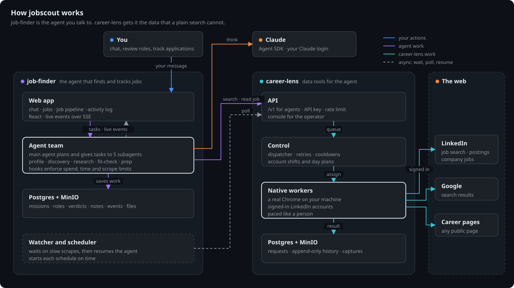
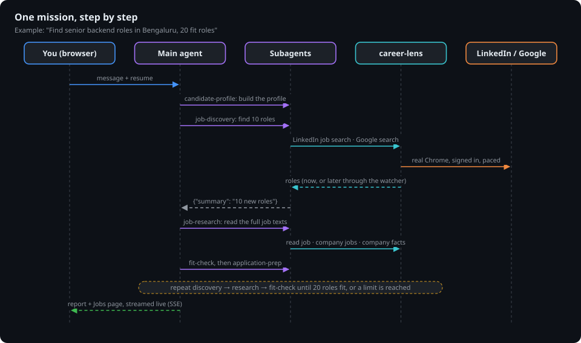

# jobscout

jobscout is an agent that finds jobs for you and helps you manage your applications.

You tell it what you want in plain words, for example
"Find senior backend roles in Bengaluru or remote India, Python or Go, 20 fit roles each weekday."
A team of agents finds the roles, reads the full job texts, checks each role against your profile and
writes an application note for each fit role. You review the roles and track your applications on one board.

jobscout has two apps:

| App | Its job |
|---|---|
| [job-finder](job-finder) | The agent that you talk to. It plans the search, gives tasks to its subagents and keeps your jobs, verdicts and notes. |
| [career-lens](career-lens) | The data tools of the agent. It reads LinkedIn while signed in, runs Google searches and reads any page, with a real Chrome on your computer. |

A plain web search cannot see most of LinkedIn. career-lens can, because it uses your own signed-in browser at a human
pace. It also keeps every result, so a second question about the same page costs nothing.

## How it works



- **job-finder** runs a main agent and five subagents on the Claude Agent SDK, with your Claude login.
  Hooks stop a goal at its spend limit, its time limit or its scrape limit.
- **career-lens** queues each scrape, gives it to a free browser and saves the result.
  The browsers run on your desktop, because LinkedIn needs a real, signed-in Chrome.
- A slow scrape does not block the agent. The watcher waits for the result and then starts the agent again.
- Guardrails keep the agent on the job search. A small model refuses a goal that is not about jobs. The agents
  cannot read local addresses or unsafe sites. They only read: they never apply or send a message. See
  [job-finder guardrails](job-finder/README.md#guardrails).

## One goal, step by step



## Run it

`docker-compose.yml` runs the two apps and their databases together. The native worker of career-lens is not a
container. It is the systemd user service `career-lens-worker`.

First start only:

```bash
./stack-env.sh                                          # writes the career-lens key and a dashboard password
docker compose run --rm jobfinder job-finder login      # saves your Claude login
systemctl --user enable --now ~/razorpay/jobscout/career-lens/deploy/career-lens-worker.service
```

Then:

```bash
docker compose up -d --build        # start everything
docker compose ps                   # see what runs
docker compose down                 # stop and keep all data
```

Do not add `-v` to `docker compose down`. It deletes the databases.

| Open | Address |
|---|---|
| job-finder | http://127.0.0.1:8000 |
| career-lens console | http://127.0.0.1:8090/console |

## Folders

| Folder | Contents |
|---|---|
| `job-finder/` | The agent, its API and its web app. See [job-finder/README.md](job-finder/README.md). |
| `career-lens/` | The scraping API, the console and the native worker. See [career-lens/README.md](career-lens/README.md). |
| `job-finder-config/` | The settings and the Claude login of job-finder in Docker. Do not commit it. |
| `docs/diagrams/` | The diagrams of this file. |

Each app has its own `AGENTS.md`, `pyproject.toml` and tests. Run the checks from the folder of the app.
