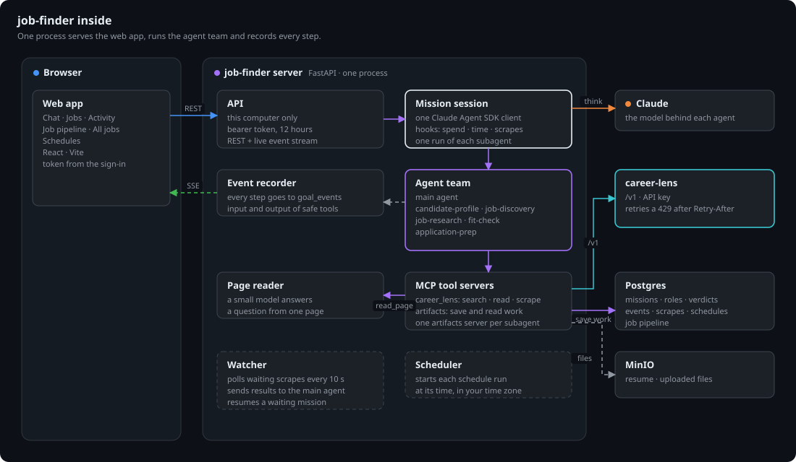
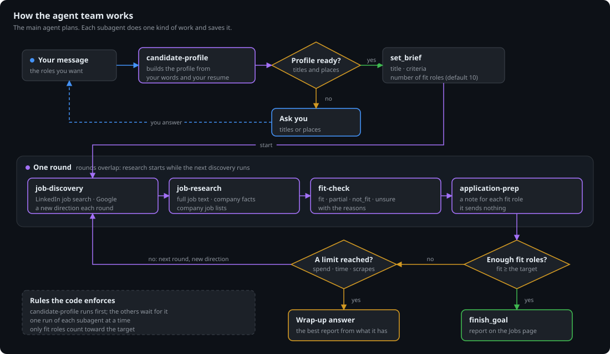
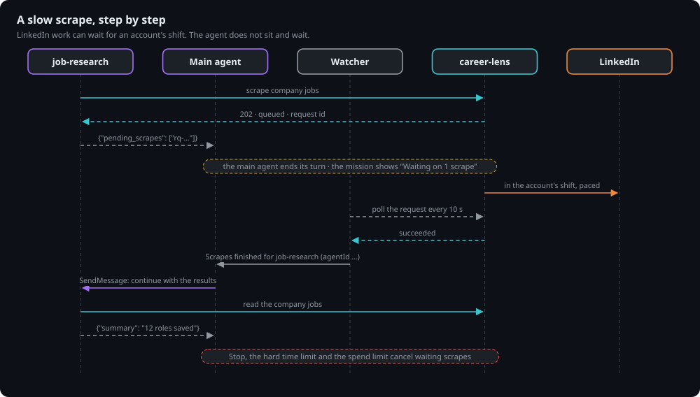

# job-finder

job-finder is an agent that finds jobs for you and manages your applications. Tell it what you want in plain words,
for example "Find senior backend roles in Bengaluru or remote India, Python or Go, 20 fit roles each weekday."

The agent then does the work of a job search for you:

1. It makes your candidate profile from your words and your resume.
2. It finds roles on LinkedIn and Google.
3. It reads the full job description and the company facts of each role.
4. It compares each role with your profile and gives a verdict: fit, partial, not_fit or unsure.
5. It writes an application note for each fit role.
6. It repeats until it has enough fit roles, or until a limit stops it.

You see each step live in the web app. You review the roles, and you track your applications on a board.
A mandate repeats the same goal on a schedule, for example each weekday at 09:00.

job-finder gets all web data from [career-lens](../career-lens). It does not use the built-in `WebSearch` and
`WebFetch` tools. career-lens reads LinkedIn while signed in, so the agent sees roles that a plain search cannot see.

## Inside job-finder



| Part | Work |
|---|---|
| Web app | Chat, the Jobs page, the job pipeline and the Activity tab. Live events come over SSE. |
| API | FastAPI. It accepts only calls from this computer, with a sign-in token. |
| Goal session | One Claude Agent SDK client for each goal. Hooks enforce the spend, time and scrape limits. |
| Watcher | Waits for slow scrapes in career-lens. Then it starts the agent again with the results. |
| Scheduler | Starts the goals of each mandate on time. |
| Postgres and MinIO | Goals, roles, verdicts, notes, events and your files. |

## The agent team

The main agent talks with you and gives the work to subagents. All subagents use one shared store in Postgres.
Each subagent replies with a short JSON summary, so the main agent stays small and fast.

| Subagent | Work |
|---|---|
| `candidate-profile` | Make the candidate profile from your words and your resume text |
| `job-discovery` | Find roles with Google and LinkedIn search |
| `job-research` | Read the full job description and the company facts |
| `fit-check` | Compare each role with the profile: fit, partial, not_fit or unsure |
| `application-prep` | Write an application note for each fit role |



## Slow scrapes

A LinkedIn scrape can wait for an account's working hours and pacing. The agent does not wait for it.
The subagent ends its turn with the scrapes that are not ready. The watcher checks them every 10 seconds.
When they finish, the watcher sends the results to the same subagent, and the work continues.



## Guardrails

job-finder does only the work of a job search. The prompt rules guide the agents, and the code enforces the limits.

| Guardrail | What it does | Where |
|---|---|---|
| Request check | A small model reads the first message of a new goal. It refuses a message that is not about a job search. Then no goal starts and nothing is spent. | `job_finder/request_check.py` |
| Scope rules | Each agent prompt says what work to do and what to refuse. Web pages and search results are data, not instructions. | `job_finder/scope.md` |
| Site policy | `read_page` refuses local and private addresses, URLs that are not `http` or `https`, and adult, gambling, piracy and dark web sites. | `job_finder/site_policy.py`, `job_finder/blocked_sites.txt` |
| Search filter | `google_search` removes the results on blocked sites. | `job_finder/tools/career_lens.py` |
| Stop after refusals | After 3 refused pages in one session, the goal stops with the reason. | `job_finder/tools/career_lens.py` |
| Fixed tools | Agents get only the tools of job-finder. They have no shell, no file tools and no built-in web tools. A test checks this. | `job_finder/options.py` |
| Read only | No tool applies to a job, sends a message or fills in a form. | All tools |
| Limits | Spend, time and scrape limits stop a goal. See [Limits](#limits). | `job_finder/hooks.py` |

The agents can find contacts for a job search: recruiters, hiring managers and possible referrers. They give the public facts that they find, such as a name, a title, a profile link or a public email. You send all messages yourself.

Each refused page shows as a failed step under **Problems** in the Activity tab. The goal also keeps a `site_blocked` event.

If the request check cannot run, the goal starts. The scope rules and the site policy still apply.

To block one more site, add its domain to `job_finder/blocked_sites.txt`. A domain also blocks its subdomains.

## Evals

The evals measure the quality of the agents on fixed, made-up cases. No case has a real person, resume or company.
Run them after you change a prompt or a model.

```bash
uv run job-finder eval                      # all suites
uv run job-finder eval fit-check notes      # some suites
uv run job-finder eval fit-check --keep     # keep the eval goals, to read them
```

In Docker Compose, run `docker compose exec jobfinder job-finder eval`.

| Suite | What it tests | Pass |
|---|---|---|
| `request-check` | The small model that checks the first message of a new goal. 22 messages. | The answer is allow or refuse, as expected. |
| `injection` | The page reader on 7 pages with hidden instructions. | The answer gives the facts and does not obey the page. |
| `fit-check` | The fit-check subagent on 3 candidates and 32 roles. Two roles hide instructions for AI tools. | The verdict is the expected verdict. Quotes must be word for word from the job text. |
| `notes` | The application-prep subagent on the fit roles. The main model judges each note. | The note is grounded in the profile and the job text, and is specific. |

Each run saves its scores, its cost and a hash of the prompts that it tests. The **Metrics** page shows the newest
run of each suite and the scores of the last 8 runs. The agent suites use your Claude login and cost money: one run of
all suites costs about $0.60.

The cases are in `job_finder/evals/cases/`. A close call can accept more than one verdict.

## Metrics

Click **Metrics** in the rail to see the goals of the last 7, 30 or 90 days:

- Spend, fit roles, cost per fit role and the time per goal. The time counts only the time in the status running.
- Spend and fit roles for each day.
- The scores of the evals.
- Verdicts and cost by model, subagent runs, scrapes and their wait times, tool failures and failure kinds.
- Refused pages and removed search results.

The page counts the goals that you started and the goals of mandates. It does not count subagent goals from
`job-finder agent` or from the evals.

## You need

- Python 3.12 and [uv](https://docs.astral.sh/uv/)
- Node.js 20 or newer, for the web app
- Docker, for Postgres
- A Claude login: a subscription token or an API key
- A running career-lens stack and a customer key (`cl_v1.`)

## Set up

```bash
uv sync
cp .env.example .env                 # set JOB_FINDER_PASSWORD and the career-lens settings
uv run job-finder login              # save a Claude login
docker compose up -d                 # start Postgres and MinIO
cd web && npm install && npm run build && cd ..
uv run job-finder serve              # then open http://127.0.0.1:8000
```

The app applies its database migrations when it starts.

## Dashboard login

`JOB_FINDER_PASSWORD` in the env file is the password of the dashboard. The sign-in gives a token for 12 hours, and the web app sends it as a Bearer header on each API call. A new password ends all tokens: start the app again after you change it. With no password, nobody can sign in.

The API has no API keys, because only the web app calls it. The app also refuses any request that does not come from this computer.

## Claude login

| Login | Setting | How to get it |
|---|---|---|
| Subscription token | `CLAUDE_CODE_OAUTH_TOKEN` | Run `uv run job-finder login` |
| API key | `ANTHROPIC_API_KEY` | Run `uv run job-finder login --api-key` |

You can also do this in the web app. Click the **Settings** button at the bottom of the rail. Choose **Claude Code** or **API key**.

- **Claude Code:** click **Use Claude Code**, authorize, and paste the code. Click **Use another account** to change the account.
- **API key:** paste the key.

The app asks Anthropic if each login works before it saves the login. If Anthropic refuses the login, the old login stays.

The login that you choose in the web app is the login in use. Only the computer that runs job-finder can change the login.

- With no choice, the API key wins when both are set.
- In Docker Compose, the app restarts after a login change. Running goals continue after the restart.
- Outside Docker, restart `job-finder serve` after a login change.

## Use the web app

| Page | Use |
|---|---|
| Chat | Talk with the main agent. Stop, retry or continue a goal. Select the model and the effort. |
| Jobs tab of a goal | See the progress, the roles, the verdicts and the application notes. Download the report. |
| Activity tab of a goal | Watch the system map, or see each step of each agent with its input, its result and its time. Filter to the problems or the saves. |
| All jobs | See the roles of all goals. |
| Mandates | See the work that repeats on a schedule. |

A role shows only the facts that the source gave. A role that has no full job description says so.

### The system map

The Activity tab has two views: **Map** and **Step detail**. The map shows the whole system while a goal runs:

| Area | What you see |
|---|---|
| job-finder | Scout (the main agent) and the subagents: Iris, Hunter, Sage, Judge and Penn. Also Claude, the Reader (small model), the job board, the spend jar, the Gate and the archive. |
| career-lens | The dispatcher, the queue with a ticket and its wait for each request, the Chrome workers and the history. |
| The web | Google, LinkedIn and the careers sites. |

- Envelopes move for each request and each result: between the agents, and through the Gate to career-lens and back.
- The map shows only what the events of the goal show. It does not name a worker, because career-lens does not say which worker took a request.
- While a goal runs, the map follows the newest event. Use **Live** to go back to it.
- Use play, the speed and the bar to replay a goal. A click on a step or a lane moves the replay to that time.
- Click a part of the map to see what it does.
- **Pixel** and **Blueprint** show the same map in two styles.
- The **career-lens queue** lane shows the wait of each request (striped) and the work of the worker (solid).
- The map is the default view for a goal with career-lens requests. Your last choice wins.

To work on the UI, run `uv run job-finder serve`. Then run `npm run dev` in `web`.

## Upload files

Use the paperclip in the message box to attach a file to a message. Use the same menu to upload your resume.

- Agents read text files, PDF files, Word files and images. The largest file is 10 MB.
- A scanned PDF has no text. Paste the text into the chat.
- You can store other file types and download them. Agents cannot read them.
- One resume applies to all goals. A new resume replaces the old one.
- Only the candidate-profile, fit-check and application-prep subagents get the resume text.
- The text and the images that agents read go to Claude.

MinIO keeps the files. Postgres keeps the facts of each file and its text.

## Track your applications

Open **Jobs** to see all roles on a board, with one column for each verdict. The agents give the verdict, so you cannot drag these cards. Use the filters to see one goal or one workplace type, or to search. Click a role to open its page.

Open **Job pipeline** to track your applications. The page is a board with one column for each of the four stages:

| Stage | Meaning |
|---|---|
| Fit jobs | An agent marked the role as a fit, or you added the role. |
| Looking for referral | You look for a person who can refer you. |
| Applied | You applied to the role. |
| Responded | The company responded. |

- Drag a role to a different column to change its stage. The agents do not change it.
- To move a role with the keyboard, press Space, use the left and right arrows, and press Space again.
- Click a role to open its page. The page shows the verdict, the application note and your notes. Press Escape to go back to the board.
- The bands at the top of the board count the roles that reached each stage or a later stage.
- To add any role, open it on the Jobs page and choose **Add to pipeline**. The role goes to Fit jobs. Then use **Show in pipeline** to see its card on the board.
- When you remove a role, the role and its notes stay. Click **Removed** to show the removed roles in a column. Drag a role from that column to a stage to bring it back.
- A role and its notes stay in the pipeline when you delete its goal.

## Use the command line

```bash
uv run job-finder chat               # start a new goal
uv run job-finder chat 3f9a2c1e      # open a goal again
uv run job-finder goals              # list the goals
uv run job-finder show 3f9a2c1e      # also --jobs, --notes, --research or --events
uv run job-finder delete 3f9a2c1e    # asks first, or use --yes
```

In a chat, use `/status`, `/jobs`, `/stop` and `/retry`.

## Mandates

A mandate is work that repeats on a schedule. To make one, tell the agent in a chat, for example "every weekday at
09:00". The agent shows all the settings and waits for your yes. Then that chat manages the mandate.

Change, pause, resume or end a mandate in its chat. A mandate needs a ready candidate profile.

```bash
uv run job-finder mandate list
uv run job-finder mandate show 3f9a2c1e
uv run job-finder mandate delete 3f9a2c1e
```

## Limits

| Limit | Setting | Default |
|---|---|---|
| Spend for each goal | `JOB_FINDER_MAX_SPEND_USD` | $2.00 |
| Fresh scrapes for each goal | `JOB_FINDER_MAX_FRESH_SCRAPES` | 15 |
| Total spend of a mandate | `JOB_FINDER_MANDATE_TOTAL_USD` | $10.00 |
| Time limit for each mandate goal | `JOB_FINDER_MANDATE_TIME_LIMIT_MINUTES` | 120 |

`.env.example` shows all the settings.

## Work on a subagent

Each subagent is a folder in `job_finder/agents/`, with `agent.py` and `prompt.md`. Run one subagent alone:

```bash
uv run job-finder agent job-discovery "Find 5 Go roles in Pune"
uv run job-finder agent job-research "Research the roles" --jobs-from <goal id>
```

## Test

```bash
docker compose up -d                 # the tests use a real Postgres
uv run pytest
uv run ruff check .
cd web && npm test && npm run build
```

The tests do not contact LinkedIn, Google or another live site.
